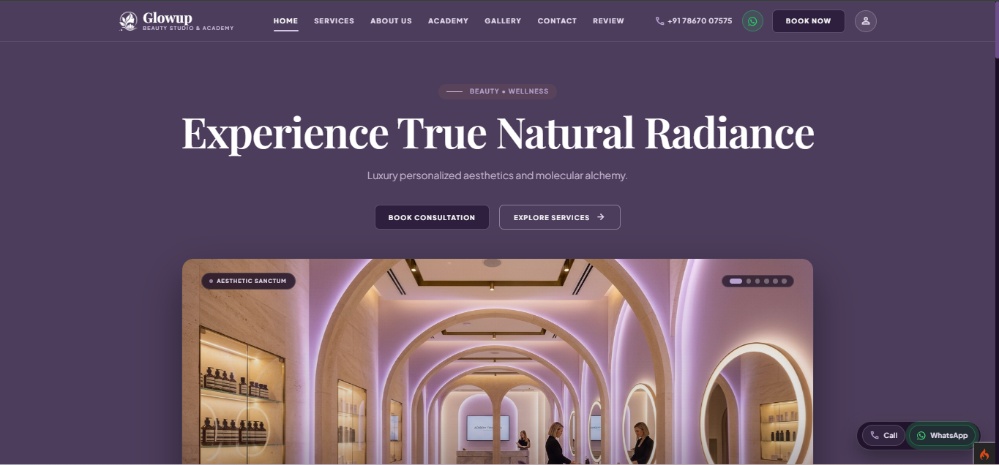
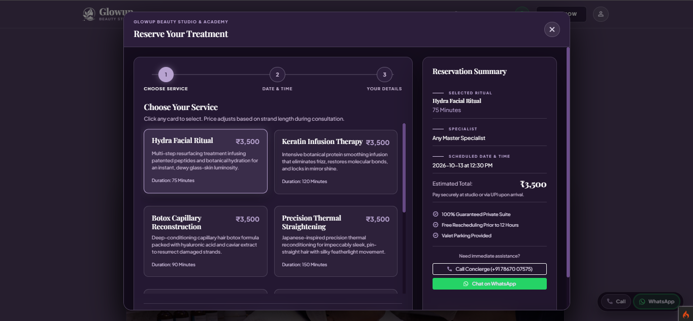
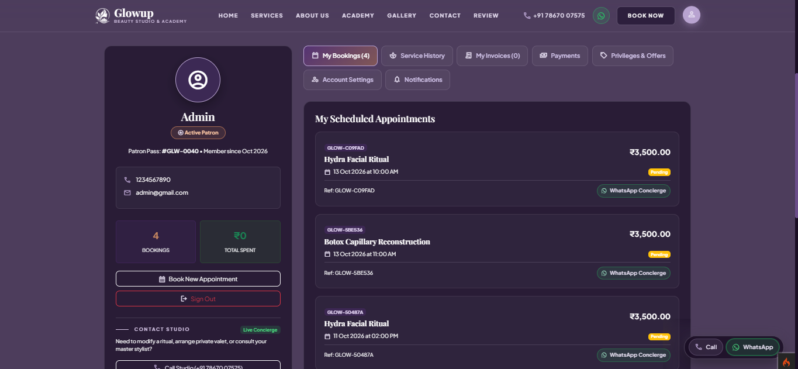
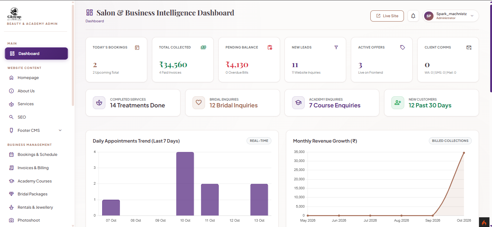

# Glow Up Beauty Studio 💄✨

A full-featured Salon & Spa Appointment Management Web Application built with **PHP (CodeIgniter 4)** and **MySQL**. Glow Up Beauty Studio connects customers with premium salon and wellness services through an interactive booking portal, while equipping salon administrators and staff with a powerful back-office management panel.

---

## Table of Contents

- [Project Overview](#project-overview)
- [Key Features](#key-features)
  - [Customer Portal](#customer-portal)
  - [Booking Experience](#booking-experience)
  - [Admin Panel](#admin-panel)
  - [Security & Authentication](#security--authentication)
- [Technology Stack](#technology-stack)
- [Project Structure](#project-structure)
- [Installation and Setup](#installation-and-setup)
- [Configuration](#configuration)
  - [Environment Variables (.env)](#environment-variables-env)
  - [Database Setup](#database-setup)
  - [Email & SMS Notifications](#email--sms-notifications)
  - [Google OAuth Setup](#google-oauth-setup)
- [Admin Capabilities](#admin-capabilities)
- [Screenshots](#screenshots)
- [Future Improvements](#future-improvements)
- [License](#license)

---

## Project Overview

**Glow Up Beauty Studio** is designed to streamline day-to-day salon operations, minimize appointment scheduling friction, and provide a seamless booking experience for clients. The platform eliminates double-bookings with real-time slot checking, handles customer loyalty discounts and promotional offers, maintains customer profiles and transaction histories, and gives management granular visibility over bookings, specialists, revenues, and marketing leads.

---

## Key Features

### 🌸 Customer Portal
- **Service Catalog & Category Browsing**: Explore beauty treatments, wellness packages, and salon services categorized by Bridal, Hair, Skin, Nails, Spa, and more.
- **Specialist Profiles & Ratings**: View team members, their specializations, and verified customer reviews.
- **Customer Authentication**: Secure registration and login with session management and "Remember Me" capabilities.
- **Social Login**: One-click sign-in via Google OAuth.
- **Self-Service Forgot / Reset Password**: Secure token-based password recovery via email with 60-minute token expiration and cryptographically secure SHA-256 tokens.
- **Client Dashboard**: View active and upcoming appointments, past booking history, invoices, and profile details.
- **Interactive Reviews & Testimonials**: Submit ratings and feedback on completed services.

### 📅 Booking Experience
- **Step-by-Step Interactive Booking**: Select service, pick a preferred specialist, choose a date, and select an available time slot.
- **Dynamic Slot Availability**: Real-time AJAX endpoint (`/booking/check-slots`) that disables already-booked time slots as clients browse available dates.
- **Server-Side Double-Booking Prevention**: Race-condition prevention guaranteeing that concurrent submissions for the same specialist, date, and time slot cannot create duplicate conflicting bookings.
- **Instant Booking Confirmation**: Automated confirmation email and SMS/WhatsApp notifications with reference IDs.

### 💼 Admin Panel
- **Operational Dashboard**: Real-time metrics tracking today's bookings, total revenue, active customers, pending appointments, and popular services.
- **Comprehensive Booking Management**:
  - Filter bookings by date range, status (*Pending*, *Confirmed*, *Completed*, *Cancelled*), and specialist.
  - Update appointment statuses, assign specialists, and manage rescheduling.
  - **CSV Export**: One-click booking export preserving active search/status filters with sanitization against CSV formula injection (`=`, `+`, `-`, `@`).
- **Service & Category Management**: Create, edit, and organize services with pricing, duration, discount prices, and featured status flags.
- **Specialist / Staff Management**: Assign services to staff members, monitor booking schedules, and update specialist statuses.
- **CRM & Lead Tracking**: Track website enquiries, leads, and follow-ups with scheduled next-action dates.
- **Promotions & Offers**: Create and manage seasonal discount banners, percentage/flat discounts, and validity periods.
- **Invoicing & Billing**: View payment records, transaction methods, invoice statuses, and printable receipts.
- **Communication Logs**: Audit trail of outbound emails, SMS messages, and WhatsApp notifications.

### 🔒 Security & Authentication
- **Role-Based Access Control (RBAC)**: Distinct permission zones for Customers (`/customer/*`) and Administrators (`/admin/*`).
- **Session Protection**: Encrypted sessions with strict CSRF protection enabled across forms.
- **Password Security**: Passwords hashed using PHP's native `PASSWORD_BCRYPT`.
- **Database Sanitization**: All queries leverage CodeIgniter 4's Query Builder and prepared statements to prevent SQL Injection.
- **XSS & Injection Protection**: Output escaping across views and CSV export formula sanitization.

---

## Technology Stack

| Layer | Technologies |
| :--- | :--- |
| **Backend Framework** | [PHP 8.2+](https://www.php.net/) &bull; [CodeIgniter 4.7](https://codeigniter.com/) |
| **Database** | [MySQL 8.0+](https://www.mysql.com/) / [MariaDB 10.4+](https://mariadb.org/) |
| **Frontend UI** | [Bootstrap 5.3.3](https://getbootstrap.com/) &bull; HTML5 &bull; CSS3 &bull; Vanilla JavaScript (Fetch API / ES6+) |
| **Typography & Icons** | Google Fonts (*Playfair Display*, *Plus Jakarta Sans*) &bull; Google Material Symbols |
| **Authentication** | CodeIgniter 4 Session Auth &bull; Google OAuth 2.0 Client API |
| **Messaging & Notifications** | CodeIgniter Email Service (SMTP) &bull; SMS Gateway &bull; WhatsApp Cloud API integration |
| **Dependency Manager** | [Composer](https://getcomposer.org/) |

---

## Project Structure

```text
glowupbeauty_studio/
├── app/
│   ├── Config/                 # Application configuration (Routes, Database, Email, Filters, etc.)
│   ├── Controllers/            # Application controllers
│   │   ├── Admin/              # Admin dashboard & resource controllers (Bookings, Services, Leads, etc.)
│   │   ├── Customer/           # Customer portal controllers (Dashboard, Bookings, Profile)
│   │   ├── AuthController.php          # Admin authentication
│   │   ├── CustomerAuthController.php  # Customer auth, Google OAuth, and Forgot/Reset password
│   │   ├── BookingController.php       # Public booking flow & dynamic slot API
│   │   └── Home.php                    # Public landing page & service showcase
│   ├── Database/               # Migrations and seeders
│   ├── Filters/                # Auth filters (AdminAuth, CustomerAuth)
│   ├── Libraries/              # Custom services (EmailService, SmsService, WhatsAppService)
│   ├── Models/                 # CodeIgniter 4 Models (BookingModel, ServiceModel, CustomerModel, etc.)
│   └── Views/                  # Presentation templates
│       ├── admin/              # Admin panel layouts and view pages
│       ├── customer/           # Customer portal views
│       ├── auth/               # Customer login, register, and password reset views
│       └── layouts/            # Shared header, footer, and navigation layouts
├── public/                     # Public web root (index.php, CSS, JS, images, uploads)
│   ├── assets/                 # Custom CSS, JavaScript, and branding assets
│   ├── uploads/                # Dynamic service and profile image uploads
│   └── index.php               # Application entry point
├── writable/                   # Cache, session files, logs, and debug toolbar data
├── .env.example                # Example environment configuration template
├── composer.json               # PHP dependency specifications
├── spark                       # CodeIgniter 4 command-line tool
└── README.md                   # Project documentation
```

---

## Installation and Setup

### Prerequisites

Ensure the following software is installed on your local environment:
- **PHP >= 8.2** with extensions: `intl`, `mbstring`, `mysqli`, `curl`, `json`
- **MySQL / MariaDB >= 8.0**
- **Composer >= 2.0**
- **Web Server**: Apache, Nginx, or PHP's built-in development server

---

### Step-by-Step Installation

1. **Clone the Repository**:
   ```bash
   git clone https://github.com/your-username/glowupbeauty_studio.git
   cd glowupbeauty_studio
   ```

2. **Install PHP Dependencies**:
   ```bash
   composer install
   ```

3. **Configure Environment File**:
   Copy `.env.example` (or `env`) to `.env`:
   ```bash
   cp env .env
   ```
   *(On Windows Command Prompt: `copy env .env`)*

4. **Set Up the Database**:
   - Create a new MySQL database named `glowup_database`:
     ```sql
     CREATE DATABASE glowup_database CHARACTER SET utf8mb4 COLLATE utf8mb4_unicode_ci;
     ```
   - Import the schema and initial data from the provided SQL dump or run migrations:
     ```bash
     php spark migrate
     ```

5. **Start the Development Server**:
   ```bash
   php spark serve
   ```
   The application will be accessible at `http://localhost:8080`.

---

## Configuration

### Environment Variables (`.env`)

Open `.env` in the project root and configure the application settings:

```ini
#--------------------------------------------------------------------
# ENVIRONMENT & BASE URL
#--------------------------------------------------------------------
CI_ENVIRONMENT = development

app.baseURL = 'http://localhost:8080/'
app.forceGlobalSecureRequests = false

#--------------------------------------------------------------------
# DATABASE CONFIGURATION
#--------------------------------------------------------------------
database.default.hostname = localhost
database.default.database = glowup_database
database.default.username = your_db_user
database.default.password = your_db_password
database.default.DBDriver = MySQLi
database.default.DBPrefix =
database.default.port = 3306
```

### Email & SMS Notifications

Configure your SMTP credentials in `app/Config/Email.php` or inside `.env` to enable appointment confirmations and password reset emails:

```ini
email.protocol = smtp
email.SMTPHost = smtp.mailtrap.io
email.SMTPUser = your_smtp_user
email.SMTPPass = your_smtp_password
email.SMTPPort = 587
email.SMTPCrypto = tls
email.fromEmail = noreply@glowupbeauty.com
email.fromName = "Glow Up Beauty Studio"
```

### Google OAuth Setup

To enable one-click Google Sign-In:
1. Create OAuth 2.0 Credentials in the [Google Cloud Console](https://console.cloud.google.com/).
2. Set the Authorized Redirect URI to: `http://localhost:8080/auth/google/callback`.
3. Add the Client ID and Client Secret in `app/Config/Google.php` or your environment variables.

---

## Admin Capabilities

The administrative portal (`/admin`) provides comprehensive salon control:

| Module | Features & Capabilities |
| :--- | :--- |
| **Dashboard** | Real-time statistics, monthly revenue graphs, quick shortcuts, upcoming schedules. |
| **Bookings** | Search by customer name, filter by date/status, update booking status, assign staff, and export to CSV. |
| **Services & Categories** | Add new treatments, set prices, assign durations, upload banners, and toggle active status. |
| **Specialists** | Manage stylist and aesthetician profiles, bio, specialties, contact details, and assigned services. |
| **Leads & Enquiries** | Review website contact enquiries, record client notes, schedule follow-ups, and track conversions. |
| **Promotions & Offers** | Publish discount codes, banner promotions, and track promotional service uptake. |
| **Invoices** | View auto-generated billing records, transaction modes (Cash, Card, UPI), and payment statuses. |
| **Reviews & Feedback** | Moderate customer reviews, publish testimonials, and monitor customer satisfaction ratings. |

---

## Screenshots

| Customer Home Page | Booking & Slot Selection |
|:---:|:---:|
|  |  |

| Customer Dashboard | Admin Management Portal |
|:---:|:---:|
|  |  |

---

## Future Improvements

Based on the architectural analysis and feature roadmap, planned future enhancements include:
- [ ] **Payment Gateway Integration**: Online payments via Stripe, Razorpay, or PayPal directly during the booking checkout step.
- [ ] **Automated Reminders**: Automated cron jobs sending SMS and WhatsApp reminders 24 hours prior to appointment times.
- [ ] **Customer Loyalty Points Program**: Reward repeat clients with redeemable points per completed service.
- [ ] **Admin Role & Permission Granularity**: Sub-roles allowing specialists to view only their own assigned bookings.
- [ ] **Multi-Branch Support**: Scale salon management across multiple studio branch locations.

---

## License

This project is licensed under the **MIT License** — see the [LICENSE](LICENSE) file for details.
