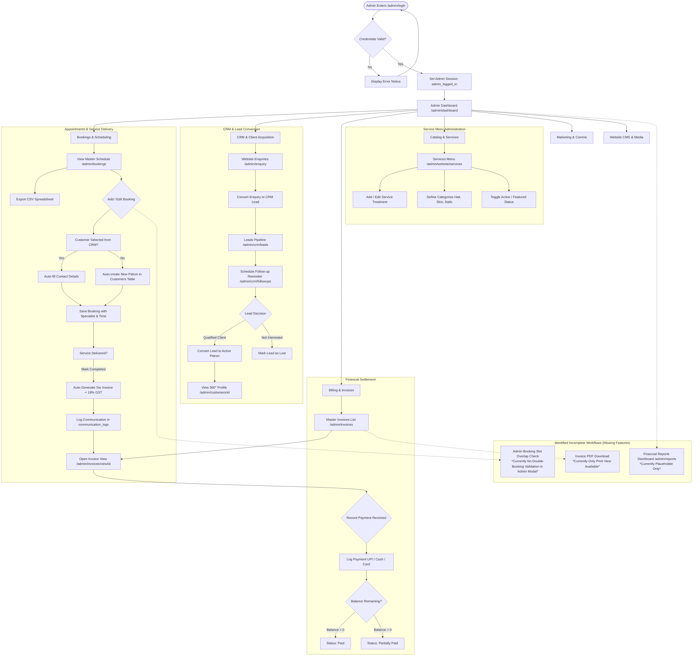

# Glow Up Beauty Studio & Academy — Admin Panel Comprehensive Analysis

## Executive Summary

This document presents a complete, code-level analysis of the **Admin Panel** for the **Glow Up Beauty Studio & Academy** platform built on **CodeIgniter 4**. 

The system currently runs a **dual architecture**:
1. **Modern Unified Glow Up Admin System** (`App\Controllers\Admin\*`): A suite of 21 controllers managing salon appointments, automated tax invoicing with GST, CRM prospect pipelines, client dossiers, academy courses, marketing offers, lookbook galleries, SEO metadata, and system integrations using a cohesive luxury plum/rose-gold glassmorphic UI (`app/Views/admin/layout/template.php`).
2. **Legacy E-Commerce Boilerplate Residue** (`App\Controllers\Beheerpaneel\*`): 36 dormant Dutch e-commerce controller files, models, and views (referencing products, webshop inventory, shipping tracking, tax codes, and bicycles/`fietsplan`) left behind from a previous template.

This analysis breaks down every module, assesses security and workflows, identifies critical gaps and redundancies, and maps the complete administrative journey.

---

## 1. Admin Panel Overview

The modern Admin Panel is accessible under the `/admin` prefix and is organized into seven operational domains.

| Domain / Section | Primary URL Route | Controller | Database Tables Used | Primary Business Purpose |
| :--- | :--- | :--- | :--- | :--- |
| **Main & Analytics** | `/admin/dashboard` | `DashboardController` | `bookings`, `invoices`, `enquiries`, `leads`, `customers`, `offers`, `reviews` | Central KPI mission control displaying daily bookings, revenue metrics, enquiry queues, trend charts, and quick actions. |
| **Appointments & Scheduling** | `/admin/bookings` | `BookingController` | `bookings`, `customers`, `services`, `invoices`, `communication_logs` | Salon service appointment scheduling, calendar status tracking, staff assignment, CSV data export, and 1-click completion with automated invoice generation. |
| **Invoicing & Billing** | `/admin/invoices` | `InvoiceController` | `invoices`, `invoice_items`, `payments`, `bookings`, `customers` | Professional salon tax billing (18% GST), payment recording (UPI/Card/Cash), balance tracking, PDF printing, and status lifecycle management (`sent`, `partially_paid`, `paid`, `overdue`, `draft`). |
| **CRM & Client Pipeline** | `/admin/crm/leads` `/admin/crm/followups` `/admin/website/customer` `/admin/customers/(:num)` | `CrmController` `CustomerController` | `leads`, `follow_ups`, `customers`, `customer_notes`, `bookings`, `invoices` | Full customer relationship management. Captures inquiries/prospects into leads, tracks follow-up reminders, converts qualified leads into active patrons, and maintains 360° client dossiers with visit histories and notes. |
| **Concierge Enquiries** | `/admin/enquiry` | `EnquiryController` | `enquiries`, `leads` | Website concierge inquiry inbox. Supports reviewing incoming messages, admin notes, status updates (`new`, `read`, `replied`), and 1-click conversion into CRM Leads. |
| **Catalog & Treatments** | `/admin/website/services` `/admin/business/bridal` `/admin/business/rentals` `/admin/business/photoshoot` `/admin/business/events` | `ServiceController` `BusinessController` | `services`, `categories`, `bridal_packages`, `rentals`, `photoshoot_packages`, `studio_events` | Service and treatment menu administration, pricing, duration, category categorization, bridal makeover packages, studio jewellery rentals, photoshoot sessions, and event management. |
| **Academy Portal** | `/admin/courses` `/admin/students` | `BusinessController` | `courses`, `students` | Academy course curriculum, syllabus, fees, duration, certifications, and student enrollment records. |
| **Marketing & Growth** | `/admin/marketing/offers` `/admin/marketing/communication-center` `/admin/settings/email-templates` | `MarketingController` `EmailTemplateController` | `offers`, `email_templates`, `communication_logs`, `customers`, `leads` | Promotional salon discount campaigns, direct broadcasting (WhatsApp, SMS, Email), communication delivery audit logs, and automated email layout templates. |
| **Media & Stories** | `/admin/website/gallery` `/admin/media/portfolio` `/admin/blog` | `MediaController` `BlogController` | `gallery_items`, `blog_posts`, `blog_categories` | Lookbook visual media management, before/after transformations, category sorting, editorial blog articles, and publication toggling. |
| **Website CMS & Layout** | `/admin/homepage` `/admin/website/aboutus` `/admin/website/footer/*` `/admin/website/reviews` | `HomepageController` `AboutController` `FooterController` `ReviewController` | `homepage_sections`, `homepage_slides`, `homepage_services`, `about_settings`, `team_members`, `footer_settings`, `footer_links`, `reviews` | Live frontend content management: homepage hero banners, philosophy statements, master stylists, footer navigation links, concierge addresses, social channels, and client review moderation. |
| **Integrations & Settings** | `/admin/settings` `/admin/settings/integrations` `/admin/settings/profile` `/admin/seo` | `SettingController` `IntegrationController` `SeoController` | `admins`, `integrations_config`, `seo_metadata`, `footer_settings` | Platform settings, WhatsApp/SMS/SMTP/Meta API credentials, meta title/description SEO tags per page, admin avatar/profile management, and secure password updates. |

---

## 2. Existing Functionality — How It Works

### 2.1 Authentication & Session Management
- **Login Flow**: Admins authenticate via `/admin/login` using `App\Controllers\Admin\AuthController::attemptLogin()`.
- **Database Verification**: `AdminAuth::attempt()` first inspects the `admins` table in MySQL. If no record is found, it falls back to a hardcoded default super-admin (`admin@glowup.com` / `Admin@12345`).
- **Session Protection**: Route groups under `/admin` are guarded by the `adminAuth` filter (`App\Filters\AdminAuthFilter`), which checks for the `admin_logged_in` session boolean and redirects guests to `/admin/login`.
- **Remember Me**: Stores a 30-day cookie (`admin_remember`) containing a Base64-encoded email to pre-fill the login input on subsequent visits.

### 2.2 Appointment Booking Lifecycle
- **Scheduling**: Admins can create appointments via the `#bookingModal` on `/admin/bookings`. They can select an existing customer from the dropdown (which auto-fills contact details) or enter new client information.
- **Client Auto-Provisioning**: If an appointment is scheduled for a phone/email not yet in the CRM, the controller automatically creates an active patron record in the `customers` table with temporary credentials (`Patron@123`).
- **Real-Time Availability & Double Booking**: The customer-facing booking engine enforces slot checks via AJAX (`/booking/check-slots`) and rejects duplicate slots server-side.
- **Completion & Invoicing**: When an admin marks an appointment as `completed`, the system:
  1. Updates the booking status to `completed`.
  2. Generates an official tax invoice in the `invoices` table with a standard 18% GST calculation.
  3. Inserts an item into `invoice_items`.
  4. Links the `invoice_id` back to the booking.
  5. Touches the customer CRM record.
  6. Dispatches an automated communication record into `communication_logs`.
- **CSV Data Export**: Admins can export appointments to a clean, Excel-compatible UTF-8 CSV via `/admin/bookings/export`. The export respects active date, status, and search filters while sanitizing potential formula injection characters.

### 2.3 CRM & Invoicing Integration
- **Lead Pipeline**: Prospects from online booking enquiries or manual entries land in `/admin/crm/leads` (`new`, `contacted`, `interested`, `follow_up`, `converted`, `lost`).
- **Follow-up Reminders**: Scheduled reminders in `follow_ups` alert the team when client follow-ups are due.
- **Lead Conversion**: A single click on `/admin/crm/leads/convert/{id}` converts the lead into an active customer in `customers` and moves the lead to `converted`.
- **Payment Collection**: On `/admin/invoices/view/{id}`, admins can record partial or full payments (UPI, Card, Cash). The controller updates `amount_paid` and `balance_due`, and flips the status to `paid` once the balance reaches zero.

### 2.4 Website Content Management (CMS)
- **Homepage & Philosophy**: Admins can edit hero taglines, banner slides, and philosophy text without modifying blade/PHP templates.
- **Services Catalog**: Categorized services with duration, pricing, and active/inactive status toggles.
- **Review Moderation**: Unmoderated patron reviews show up with an alert badge in the sidebar; admins can inspect, approve, feature, or delete them.
- **SEO Meta Control**: Meta titles, descriptions, and OpenGraph parameters can be configured per page via `/admin/seo`.

---

## 3. Important Features (Must Maintain & Enhance)

These are the core revenue-generating and operational pillars of the platform:

1. **Bookings & Schedule Management (`/admin/bookings`)**:
   - The central operational hub of the salon.
   - Immediate value: status tracking, specialist assignments, conflict checks, and CSV data exports.
2. **Automated Tax Invoicing (`/admin/invoices`)**:
   - Eliminates manual billing mistakes by auto-calculating 18% GST upon service completion.
   - Provides clear audit trails of paid vs. overdue accounts and tracks payment reference numbers.
3. **CRM Pipeline & 360° Customer Profiles (`/admin/crm/leads` & `/admin/customers/{id}`)**:
   - Stores visit history, lifetime billings, notes, and preferences (hair type, skin sensitivities).
   - High customer lifetime value for repeat salon treatments and academy enrollments.
4. **Services & Treatment Catalog (`/admin/website/services`)**:
   - Drives frontend booking options, price displays, and duration calculations.
5. **Concierge & Enquiry Lead Conversion (`/admin/enquiry`)**:
   - Bridges website visitors directly into the business sales funnel with a single click.
6. **Communication Center & Integrations (`/admin/marketing/communication-center` & `/admin/settings/integrations`)**:
   - Multi-channel notification capabilities (WhatsApp, SMS, Email) for appointment reminders and marketing campaigns.

---

## 4. Unnecessary & Redundant Features

During the codebase inspection, several unused and redundant components were identified that clutter the application.

### 4.1 Dead Legacy E-Commerce Boilerplate (`App\Controllers\Beheerpaneel\*`)
- **Found in**: `app/Controllers/Admin/` (36 files named `Product.php`, `Category.php`, `Orders.php`, `Shipments.php`, `Discountcode.php`, `Vacatures.php`, `Cookies.php`, `Brand.php`, `Subadmin.php`, etc.).
- **Why It Is Unnecessary**:
  - These controllers belong to a legacy Dutch e-commerce/bicycle (`fietsplan`) webshop framework (`namespace App\Controllers\Beheerpaneel`).
  - None of these controllers are registered in `app/Config/Routes.php`.
  - They reference non-existent database tables (`product`, `orders`, `shipments`, `users`).
  - They present confusion and clutter the codebase.

### 4.2 Dead Legacy View Files
- **Found in**: `app/Views/admin/Tax/`, `app/Views/admin/product/`, `app/Views/admin/orders/`, `app/Views/admin/shippingmethods/`, `app/Views/admin/bulkimport/`, `app/Views/admin/template/sidebar.php`.
- **Why It Is Unnecessary**:
  - The live application uses `app/Views/admin/layout/template.php`.
  - The old `app/Views/admin/template/sidebar.php` points to dead `/beheerpaneel/*` routes and outdated jQuery scripts.

### 4.3 Redundant & Duplicate Routes
- **Duplicate Service Routes**:
  - Route `/admin/services` and `/admin/website/services` both point to `Admin\ServiceController::index`.
  - `/admin/services` renders the placeholder `admin/pages/services.php` if accessed directly, while `/admin/website/services` renders the actual active management view `admin/pages/website_services.php`.
- **Duplicate Customer Routes**:
  - Route `/admin/clients` renders the placeholder `admin/pages/clients.php`.
  - Meanwhile, `/admin/website/customer` renders the complete, functional `admin/pages/website_customer.php`.
- **Duplicate Reviews Routes**:
  - Route `/admin/reviews` and `/admin/system/reviews` point to the placeholder `PageController::systemReviews`, while the real review manager runs under `/admin/website/reviews`.

---

## 5. Missing & Incomplete Features

The following gaps exist between the UI controls and full backend implementation:

### 5.1 Placeholder Pages Requiring Full Integration
The following admin views currently display "Empty placeholder view" banners and lack backend functionality:
1. **Academy Web Portal (`/admin/website/academy`)**:
   - Renders `admin/pages/website_academy.php` placeholder. While `/admin/courses` and `/admin/students` work under `BusinessController`, the dedicated academy web portal view is not wired up.
2. **Business Reports & Financial Analytics (`/admin/reports`)**:
   - Renders `admin/pages/reports.php` placeholder. Basic metrics exist on the Dashboard, but there is no dedicated reports page to view monthly revenue comparisons, staff commissions, or popular treatments.
3. **Concierge Contact Page Content Editor (`/admin/website/contact`)**:
   - Renders `admin/pages/website_contact.php` placeholder. General studio contact info is handled in Footer Settings, but a dedicated contact page editor does not exist.
4. **Website Invoice Settings (`/admin/website/invoice`)**:
   - Renders `admin/pages/website_invoice.php` placeholder.

### 5.2 Missing Operational Logic
1. **Admin Booking Double-Booking Check**:
   - While the frontend customer booking flow verifies slot availability and prevents double bookings, the admin form (`BookingController::save()`) does not check for overlapping bookings. An admin can inadvertently schedule two clients with the same specialist at the same date and time.
2. **Granular Multi-User Role & Permission Control**:
   - The modern admin system uses a single admin session check (`admin_logged_in`). There is currently no role-based access control (RBAC) to differentiate between a Receptionist, Master Stylist, and Super Administrator.
3. **Invoice PDF Download & Printing**:
   - While `/admin/invoices/view/{id}` renders a printable HTML invoice, there is no direct "Download PDF" server-side generator (e.g., via Dompdf).

---

## 6. Security Review

### 6.1 Authentication & Credentials
- **Hardcoded Fallback Super-Admin**:
  - `AdminAuth.php` contains a fallback credential check (`admin@glowup.com` / `Admin@12345`). If the `admins` table is empty or the user record is not present, this fallback allows access.
  - *Risk*: If deployed to production with this default password intact, unauthorized users could gain administrative access.
  - *Recommendation*: Enforce an initial setup wizard that requires changing this password, or seed a randomized password during installation.

### 6.2 "Remember Me" Cookie Implementation
- **Current Behavior**:
  - `AdminAuth::setAdminSession()` sets `admin_remember` storing `base64_encode($admin['email'])`.
  - In `AuthController::login()`, the cookie is decoded only to prefill the email input field on the login form.
  - *Assessment*: Because the cookie does not bypass password entry, this does not pose an authentication bypass risk; however, using Base64 encoding for email values exposes client emails in cleartext cookies.

### 6.3 CSRF (Cross-Site Request Forgery) Protection
- **Status**: CodeIgniter 4 CSRF protection is active globally in `app/Config/Filters.php`.
- **Forms**: Verified that forms in `admin/pages/bookings.php`, `admin/pages/website_services.php`, `admin/pages/invoices.php`, and `admin/pages/customer_profile.php` utilize `<?= csrf_field() ?>`.
- **Caveat on DELETE Actions**:
  - Routes like `$routes->match(['get', 'post'], 'bookings/delete/(:num)', ...)` allow HTTP `GET` requests to trigger deletion.
  - *Risk*: A malicious third-party site embedding `` could trigger a delete request if the admin is authenticated.
  - *Recommendation*: Restrict all state-changing operations (delete, toggle, convert) exclusively to `POST` or `DELETE` requests with CSRF tokens.

### 6.4 Input Validation & CSV Injection
- **Validation**: Modern controllers enforce CI4 validation rules (`valid_email`, `required`, `numeric`, `valid_date`).
- **CSV Formula Injection**: Resolved in `BookingController::exportCsv()` with `sanitizeCsvField()`, neutralizing dangerous formula characters (`=`, `+`, `-`, `@`, `\t`, `\r`).

---

## 7. Recommendations (Prioritized)

### High Priority (Immediate Action Required)
1. **Remove Hardcoded Default Admin Credentials**:
   - Ensure the database `admins` table has a primary administrator created, and disable or remove the static fallback password (`Admin@12345`) in `AdminAuth.php`.
2. **Restrict Destructive Routes to POST Only**:
   - Change `$routes->match(['get', 'post'], ...)` to `$routes->post(...)` for all delete and toggle actions across bookings, services, invoices, leads, and reviews.
3. **Add Double-Booking Conflict Prevention in Admin Booking Modal**:
   - Implement slot collision checks in `BookingController::save()` to prevent admins from creating overlapping appointments for the same specialist.

### Medium Priority (Short-Term Improvements)
1. **Clean Up Legacy Boilerplate (`Beheerpaneel`)**:
   - Safely archive or remove the 36 unused controllers in `App\Controllers\Beheerpaneel` and their associated views in `app/Views/admin/Tax`, `bulkimport`, `orders`, etc., to reduce cognitive load and prevent accidental exposure.
2. **Standardize Redundant Routes and Remove Placeholder Clones**:
   - Deprecate `/admin/clients` in favor of `/admin/website/customer`.
   - Deprecate `/admin/services` in favor of `/admin/website/services`.
   - Deprecate `/admin/reviews` in favor of `/admin/website/reviews`.
3. **Implement Real PDF Invoice Generation**:
   - Integrate a lightweight PDF library (e.g. `dompdf/dompdf`) so admins can generate downloadable PDF tax invoices for email attachments and offline bookkeeping.

### Low Priority (Future Architectural Enhancements)
1. **Role-Based Access Control (RBAC)**:
   - Introduce user roles (`Receptionist`, `Stylist`, `Accountant`, `Manager`) with granular permission flags to limit financial and system settings access.
2. **Build Out the Dedicated Financial Analytics Page (`/admin/reports`)**:
   - Convert `reports.php` into a working dashboard for month-over-month revenue, top-performing stylists, and service profitability.

---

## 8. Affected Files & Architecture Catalog

### Controllers
- **Active Core Admin Controllers** (`app/Controllers/Admin/`):
  - `AuthController.php` (Admin session login/logout)
  - `DashboardController.php` (Analytics & KPI dashboard)
  - `BookingController.php` (Appointments, schedules, CSV export)
  - `InvoiceController.php` (Billing, GST calculations, payment logging)
  - `ServiceController.php` (Service menu & categories)
  - `CustomerController.php` (Customer dossiers & 360° profile)
  - `CrmController.php` (Leads pipeline & follow-up scheduling)
  - `EnquiryController.php` (Website concierge messages)
  - `MarketingController.php` (Offers & multi-channel campaigns)
  - `EmailTemplateController.php` (Automated email templates)
  - `IntegrationController.php` (API credentials & gateway testing)
  - `BusinessController.php` (Courses, bridal, rentals, photoshoot)
  - `MediaController.php` (Gallery lookbook & portfolio)
  - `BlogController.php` (Editorial stories & categories)
  - `ReviewController.php` (Patron review approval & moderation)
  - `HomepageController.php` (Hero banners & philosophy CMS)
  - `AboutController.php` (Team members & studio story)
  - `FooterController.php` (Footer columns & social links)
  - `SeoController.php` (Meta title & description management)
  - `SettingController.php` (Studio configuration & password updates)
  - `PageController.php` (Secondary routes & legacy placeholders)

### Models (`app/Models/`)
- `AdminModel.php`, `BookingModel.php`, `InvoiceModel.php`, `InvoiceItemModel.php`, `PaymentModel.php`, `CustomerModel.php`, `LeadModel.php`, `FollowUpModel.php`, `ServiceModel.php`, `CategoryModel.php`, `EnquiryModel.php`, `OfferModel.php`, `EmailTemplateModel.php`, `IntegrationModel.php`, `CommunicationLogModel.php`, `ReviewModel.php`, `GalleryModel.php`, `BlogModel.php`, `BlogCategoryModel.php`, `CourseModel.php`, `StudentModel.php`, `BridalModel.php`, `RentalModel.php`, `PhotoshootModel.php`, `EventModel.php`, `FooterSettingsModel.php`, `SeoModel.php`.

### Views (`app/Views/admin/`)
- **Master Layout**: `app/Views/admin/layout/template.php`
- **Active Views**: `app/Views/admin/pages/` (`dashboard.php`, `bookings.php`, `invoices.php`, `invoice_view.php`, `website_services.php`, `website_customer.php`, `customer_profile.php`, `crm_leads.php`, `crm_followups.php`, `enquiries.php`, `offers.php`, `communication_center.php`, `email_templates.php`, `integrations.php`, `courses.php`, `students.php`, `bridal.php`, `rentals.php`, `photoshoot.php`, `events.php`, `website_gallery.php`, `portfolio.php`, `blog.php`, `website_reviews.php`, `homepage.php`, `website_aboutus.php`, `footer_brand.php`, `seo.php`, `settings.php`, `profile.php`).

### Database Tables (MySQL)
- `admins`, `bookings`, `invoices`, `invoice_items`, `payments`, `customers`, `customer_notes`, `leads`, `follow_ups`, `enquiries`, `services`, `categories`, `offers`, `email_templates`, `integrations_config`, `communication_logs`, `reviews`, `gallery_items`, `blog_posts`, `blog_categories`, `courses`, `students`, `bridal_packages`, `rentals`, `photoshoot_packages`, `studio_events`, `homepage_sections`, `homepage_slides`, `homepage_services`, `about_settings`, `team_members`, `footer_settings`, `footer_links`, `seo_metadata`.

---

## 9. Admin Workflow Map

The following Mermaid diagram outlines the end-to-end administrative workflow from authentication through scheduling, customer relationship management, billing, and content management.

### Explanation of the Diagram
1. **Entry & Mission Control**: The admin authenticates through `/admin/login`, which initializes the session and routes to the **Dashboard** (`/admin/dashboard`).
2. **Operations & Revenue Engine**:
   - The admin manages appointments in **Bookings**. New clients are automatically added to the CRM `customers` table.
   - Marking a booking as **Completed** triggers an automated flow: generating a tax invoice with 18% GST, creating invoice line items, and recording a log in `communication_logs`.
   - The admin is then directed to **Invoice View**, where payments (UPI, Card, Cash) are logged until the balance due reaches zero.
3. **Client Acquisition Funnel**:
   - Public website inquiries land in **Enquiries**.
   - With 1 click, inquiries become **CRM Leads**, where follow-up calls are scheduled.
   - When a lead commits, they are converted into an active **Customer** with a complete profile tracking past treatments and invoices.
4. **Catalog & Website Control**:
   - The **Services** module sets treatments, pricing, and categories that populate both the public site and admin scheduling dropdowns.
5. **Highlighted Missing Workflows**:
   - **M1**: The admin booking modal lacks the double-booking validation present on the customer frontend.
   - **M2**: The Reports section (`/admin/reports`) currently shows a placeholder page rather than aggregated financial reports.
   - **M3**: Invoices can be printed via browser print styling, but there is no server-side PDF download feature.
